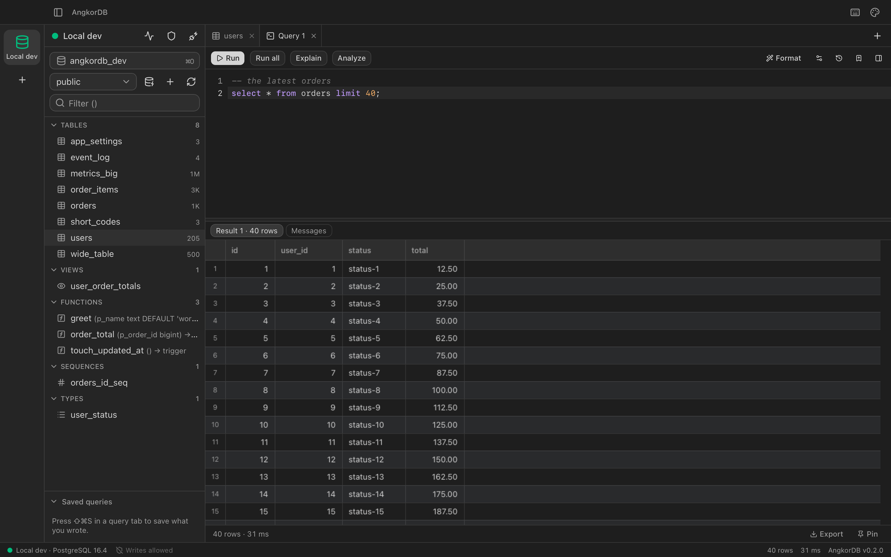

<p align="center">
  
</p>

<h1 align="center">AngkorDB</h1>

<p align="center">
  A fast, native-feeling PostgreSQL client for macOS.<br />
  Browse, query, edit and manage your databases. No account, no telemetry.
</p>

<p align="center">
  <a href="https://github.com/putheka/AngkorDB/releases">Download</a> ·
  <a href="#features">Features</a> ·
  <a href="#install">Install</a> ·
  <a href="#development">Development</a>
</p>

<p align="center">
  
  
  
</p>

<p align="center">
  
</p>

## Features

- **Many connections at once.** A left rail switches between open connections; each keeps its own tabs. Open more windows with ⇧⌘N.
- **Secure connections.** SSH tunnel (password, key or `ssh-agent`, jump host) and SSL up to Verify Full. Passwords stay in the macOS Keychain.
- **Safe mode.** Per connection: confirm writes, Touch ID for writes, or read-only. Edits are staged, and you can see the exact SQL before you save.
- **Fast data grid.** Handles very large tables. Sort, filter by conditions or raw `WHERE`, edit cells, follow foreign keys, JSON editor.
- **SQL editor.** Autocomplete, run statement or selection, several result tabs, `EXPLAIN` plan view, history and saved queries, optional Vim keys.
- **Structure and admin.** Tables, columns, indexes, constraints, DDL, roles and privileges, and a live activity monitor.
- **Import, export, backup.** CSV and JSON in; CSV, JSON, SQL and Markdown out; `pg_dump` and `pg_restore` for backups.
- **Feels like a Mac app.** ⌘K command palette, ⌘P find any table, light and soft dark themes, auto-update.

|                                                                                              |                                                                                       |
| -------------------------------------------------------------------------------------------- | ------------------------------------------------------------------------------------- |
|         |      |
|  |  |

<sub>Screenshots are from the browser development build, with sample data.</sub>

## Install

1. Download the `.dmg` from the [Releases page](https://github.com/putheka/AngkorDB/releases) and drag AngkorDB to Applications.
2. The first time, macOS says it can't verify the app because it isn't notarized. Open **System Settings → Privacy & Security** and click **Open Anyway**. If it says the app is "damaged", run this once:

```bash
xattr -cr /Applications/AngkorDB.app
```

Later updates install from inside the app (**AngkorDB → Check for Updates…**). Requires macOS 11 or newer.

## Development

You need Node.js 20+, stable Rust and the Xcode Command Line Tools.

```bash
npm install
npm run tauri dev    # the app, with hot reload
npm run dev          # just the UI in a browser, with a mock backend
npm run db:up        # test Postgres 16 in Docker (optional)
npm run check        # typecheck, lint, format, unit and Rust tests
```

The UI is React + TypeScript; the backend is Rust (`tokio-postgres`). Rust commands and types are exported to TypeScript with [tauri-specta](https://github.com/specta-rs/tauri-specta), so the two sides can't drift apart.

To release, set the same version in `tauri.conf.json`, `Cargo.toml` and `package.json`, then push a tag like `v0.2.0`. The [Release workflow](.github/workflows/release.yml) builds a universal DMG as a draft release.

## Contributing

Bug reports and ideas are welcome as GitHub issues. For a code change, open an issue first, and run `npm run check` before a pull request.

## License

[MIT](LICENSE)
